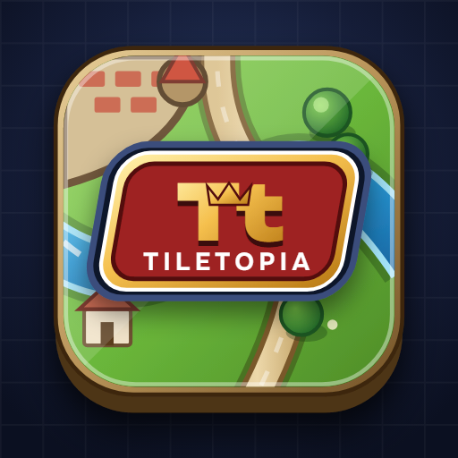
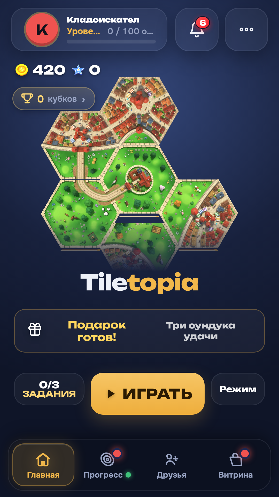
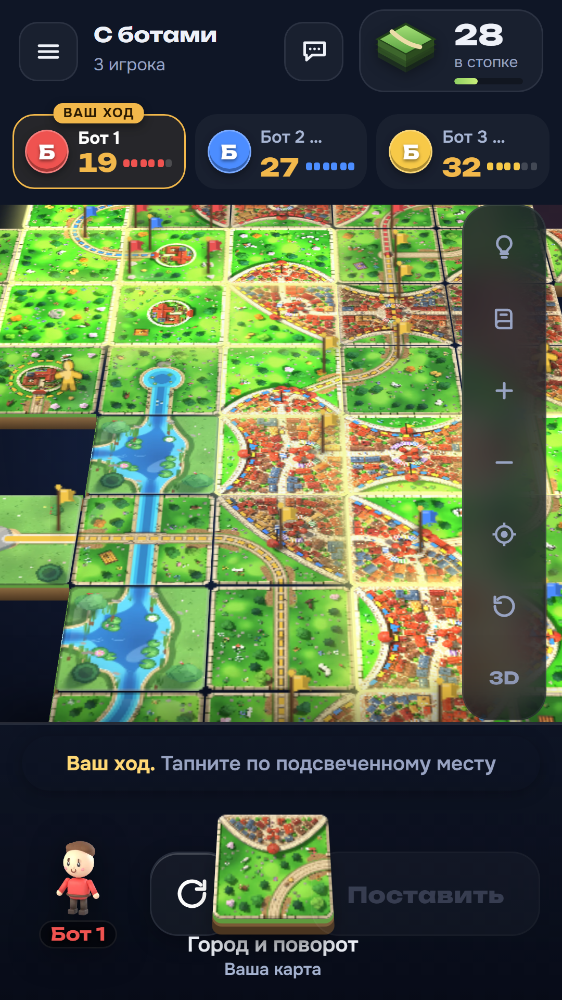
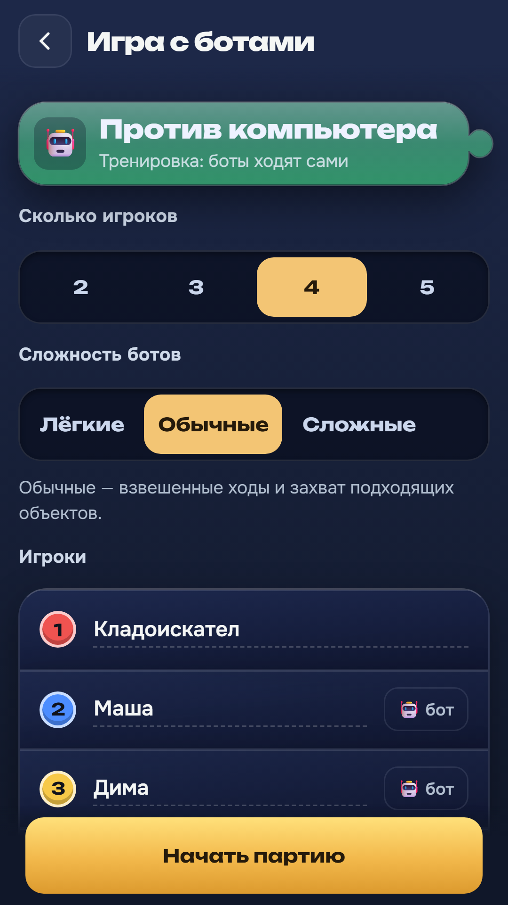
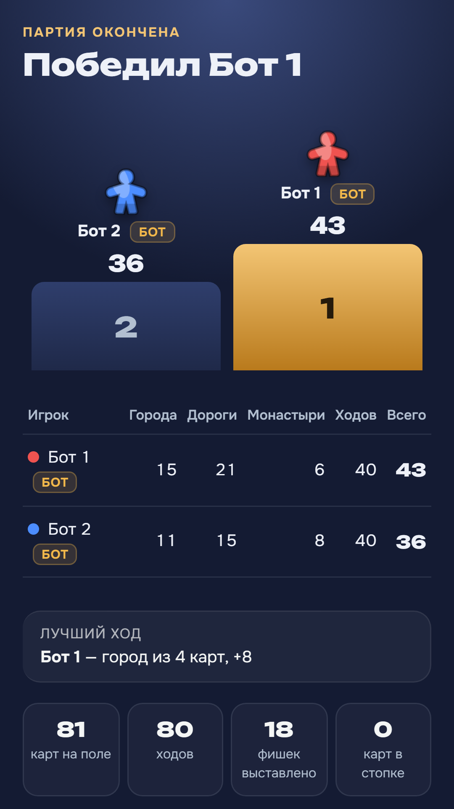

<h1 align="center">Tiletopia</h1>

Настольная стратегия, где города, дороги и реки растут из плиток.

  <a href="https://crownfall90-dot.github.io/TileTopia/"><b>Играть в браузере</b></a> ·
  <a href="https://github.com/crownfall90-dot/TileTopia/releases/latest/download/Tiletopia.apk"><b>Скачать APK</b></a> ·
  <a href="https://github.com/crownfall90-dot/TileTopia/releases/latest"><b>Последний релиз</b></a>

  
  

  
  
  
  

## Как играть

Выбирайте плитку, продолжайте дороги и реки, достраивайте города и решайте, какие объекты занять фишками. Квадратное поле «Классики» и шестиугольные плитки «Классики 2.0» дают разные варианты хода.

- Тренируйтесь с ботами трёх уровней сложности или играйте по очереди на одном устройстве.
- Приглашайте друзей по коду комнаты или ищите соперников в рейтинговой игре.
- Выполняйте задания, открывайте фигурки, рамки и баннеры профиля.
- Продолжайте сохранённую локальную партию после перерыва.

## Где играть

- **Android** — скачайте APK из [последнего релиза](https://github.com/crownfall90-dot/TileTopia/releases/latest).
- **Телефоны, планшеты и компьютеры** — откройте [веб-версию](https://crownfall90-dot.github.io/TileTopia/). На совместимых браузерах её можно добавить на домашний экран.
- За правилами игры и вопросами об установке обращайтесь к [справке Tiletopia](https://crownfall90-dot.github.io/TileTopia/about.html). Идею или ошибку можно отправить из меню «Настройки → Написать разработчику».

[Политика конфиденциальности](https://crownfall90-dot.github.io/TileTopia/privacy.html) · [Удаление аккаунта и данных](https://crownfall90-dot.github.io/TileTopia/delete-account.html) · [English](https://crownfall90-dot.github.io/TileTopia/about-en.html)

© 2026 Crownfall. Все права защищены. Подробные условия приведены в [LICENSE](LICENSE). Об уязвимостях сообщайте через [приватный канал](SECURITY.md).

<b>Раздел для разработчиков и участников команды</b>

Рабочий репозиторий проекта **Tiletopia**.

Перед началом работы ознакомьтесь с [docs/product/README.md](docs/product/README.md) (видение, механики, сезонные локации, аудит) и [docs/coordination/HANDOFF.md](docs/coordination/HANDOFF.md).

- **Архитектура:** `web/game.html` + `src/` (модули собираются через Vite в `build/bundle/pg.js`), `app/` — нативная Android-оболочка (Gradle / Java), `scripts/` — пайплайн сборки, `tests/` — модульные тесты (`node --test tests/*.test.cjs`).
- **Сборка веб-модулей:** `npm run build`.
- **Запуск тестов:** `npm test`.
- **Развитие движка:** [архитектура и решение по Rust/WebAssembly](docs/ENGINEERING-ROADMAP.md).
- **Google Play:** [материалы и подготовка рынков](docs/product/PLAY-RELEASE.md).
- **Ключи и подпись:** [docs/SIGNING-KEY-ROTATION.md](docs/SIGNING-KEY-ROTATION.md); регламент безопасности репозитория — [docs/REPO-SECURITY.md](docs/REPO-SECURITY.md).

