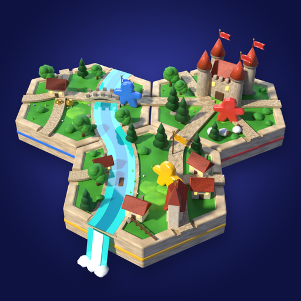
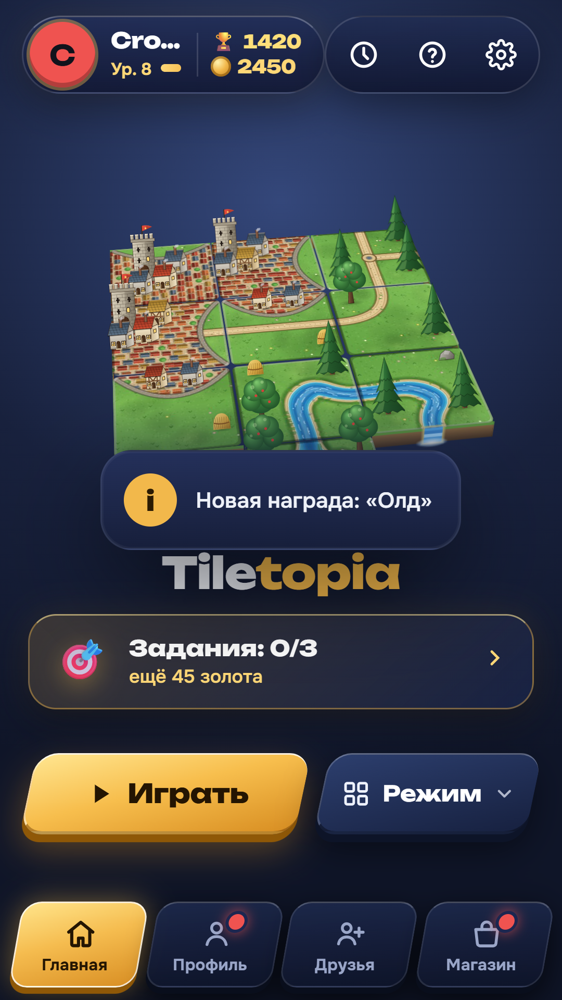
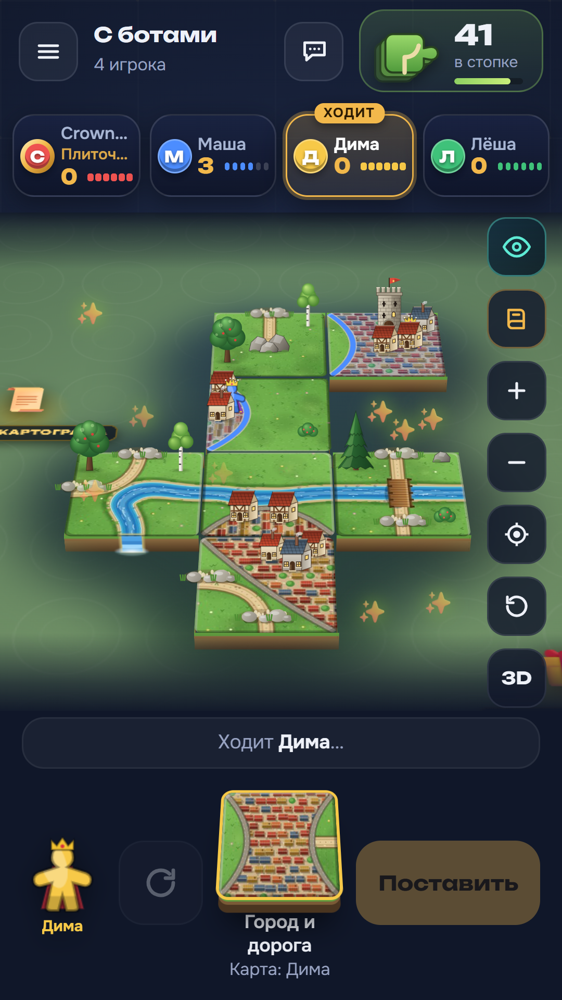
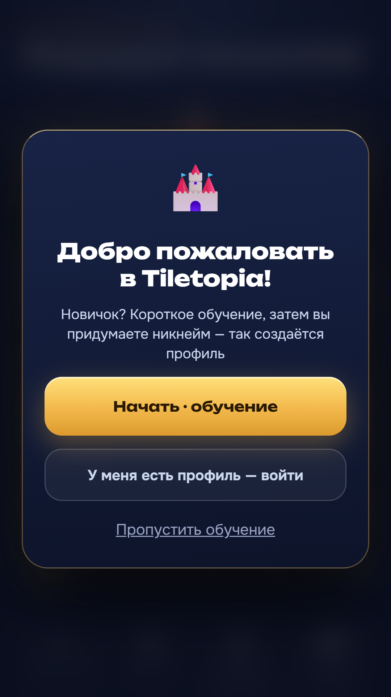

  

<h1 align="center">TileTopia</h1>

  <b>Создавайте живые миры из плиток: открывайте новые локации и играйте вместе!</b>

  
  
  
  

  <a href="https://crownfall90-dot.github.io/TileTopia/"><b>▶ Играть в браузере</b></a> ·
  <a href="https://github.com/crownfall90-dot/TileTopia/releases/latest/download/Tiletopia.apk"><b>⬇ Скачать для Android (APK)</b></a> ·
  <a href="docs/privacy-policy.md">Политика конфиденциальности</a>

  
  
  
  

---

## 🗺️ О стратегии

Добро пожаловать в **TileTopia** — развивающуюся настольную стратегию о созидании миров, где каждая выложенная плитка формирует живой и неповторимый ландшафт!

TileTopia объединяет лёгкость освоения, свободу творчества и глубину тактической игры. Шаг за шагом соединяйте дороги, реки, поселения и природные просторы, создавая цветущие земли и открывая новые стратегические возможности.

### 🌟 Что вас ждет в TileTopia:

* **Сезонные локации и развивающийся мир**  
  Игра растет и меняется вместе с вами! В финале каждого рейтингового сезона мир TileTopia пополняется крупным обновлением с новой тематической локацией, своими правилами застройки и уникальной архитектурой:
  * **«Деревня» (активна уже сейчас)** — классические цветущие равнины, извилистые реки, старинные тракты и неприступные крепости.
  * **«Мегаполис» (в разработке)** — современная сетка широких проспектов, деловые кварталы, линии метро и сияющие небоскрёбы.
  * **«Сибирь» (в разработке)** — суровые северные зимники, деревянные остроги, густая тайга и замерзшие русла рек.
  * **«Джунгли» (в разработке)** — затерянные тропы сквозь непроходимые заросли, древние каменные руины и величественные пирамиды.

* **Разнообразие игровых форматов**  
  Выбирайте темп, который подходит именно вам:
  * **Дзен-режим**: спокойное строительство и созидание в свое удовольствие без таймеров, спешки и давления.
  * **Тактические сценарии**: увлекательные миссии с ограниченным запасом плиток и особыми условиями победы.
  * **Онлайн-противостояние**: динамичные дуэли и соревновательные матчи, где каждый ход меняет расстановку сил на общей карте.

* **Играйте в одиночку или с друзьями**  
  Создавайте закрытые комнаты для уютных вечеров в компании друзей, участвуйте в открытых лигах и поднимайтесь на вершину сезонного рейтинга. Доступна игра с ботами трёх уровней сложности и хот-сит на одном устройстве.

* **Приятная атмосфера и чистый геймплей**  
  Красочный визуальный стиль, плавные анимации и удобное управление. Никакой навязчивой рекламы — наслаждайтесь честным игровым процессом в своем ритме.

*Постройте свой идеальный край, найдите победную тактику и открывайте новые эпохи TileTopia с каждым сезоном!*

---

## 📲 Установка и запуск

* **Android:** скачайте актуальный [Tiletopia.apk](https://github.com/crownfall90-dot/TileTopia/releases/latest/download/Tiletopia.apk) и установите на смартфон. Встроенный апдейтер автоматически предложит новые версии по мере их выхода.
* **iPhone, планшеты и ПК:** запустите [веб-версию игры](https://crownfall90-dot.github.io/TileTopia/) в браузере и добавьте ярлык на домашний экран (полная поддержка PWA и офлайн-режима).

---

## 🛡️ Безопасность и поддержка

* Если вы обнаружили ошибку или хотите предложить идею: используйте меню «Настройки → Написать разработчику» прямо в игре.
* Уязвимости безопасности обрабатываются приватно согласно регламенту в [SECURITY.md](SECURITY.md).

## 📄 Авторские права

© 2026 Crownfall. Все права защищены. Код, графика, звуковое оформление и тексты игры — собственность автора; копирование, распространение и использование в коммерческих и сторонних проектах без письменного согласия правообладателя запрещены. Подробные условия — в файле [LICENSE](LICENSE).

---

<b>Раздел для разработчиков и участников команды</b>

Рабочий репозиторий проекта **TileTopia**.  
Перед началом работы ознакомьтесь с [docs/product/README.md](docs/product/README.md) (видение, механики, сезонные локации, аудит) и [docs/coordination/HANDOFF.md](docs/coordination/HANDOFF.md).

- **Архитектура:** `web/game.html` + `src/` (модули собираются через Vite в `build/bundle/pg.js`), `app/` — нативная Android-оболочка (Gradle / Java), `scripts/` — пайплайн сборки, `tests/` — модульные тесты (`node --test tests/*.test.cjs`).
- **Сборка веб-модулей:** `npm run build`.
- **Запуск тестов:** `npm test`.
- **Ключи и подпись:** [docs/SIGNING-KEY-ROTATION.md](docs/SIGNING-KEY-ROTATION.md); регламент безопасности репозитория — [docs/REPO-SECURITY.md](docs/REPO-SECURITY.md).

