# 🧩 Спрайты плиток Tiletopia (512×512)

Все плитки игры, экспортированные в высоком разрешении 512×512 px.
Вы можете открывать и дорабатывать каждую плитку в Photoshop, Figma, Aseprite или любом другом графическом редакторе.

Также для интерактивного просмотра и выгрузки ZIP доступен инструмент: `tools/export-tiles.html`.

## Список плиток (37 шт):

| Превью | Файл | Название | Стороны (N E S W) |
|---|---|---|---|
| 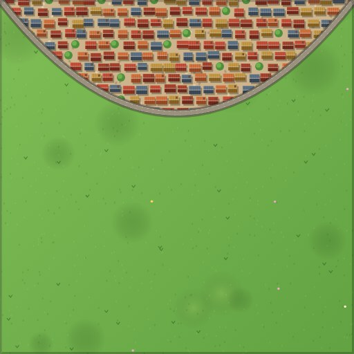 | `tile_cap.png` | **Край города** | `cfff · ×5` |
| 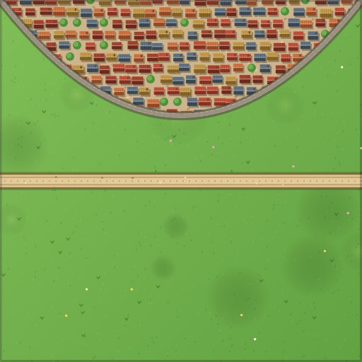 | `tile_capRS.png` | **Город и дорога** | `crfr · ×4` |
| 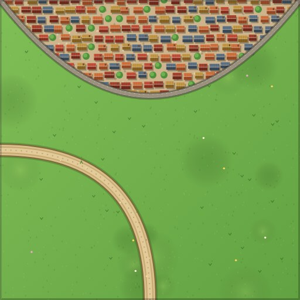 | `tile_capRL.png` | **Город и поворот** | `cfrr · ×3` |
| 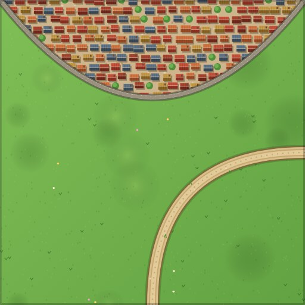 | `tile_capRR.png` | **Город и поворот** | `crrf · ×3` |
| 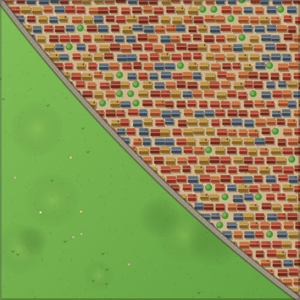 | `tile_c2.png` | **Угол города** | `ccff · ×3` |
| 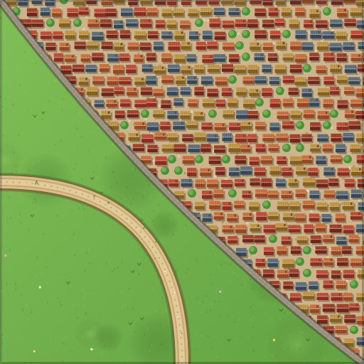 | `tile_c2r.png` | **Угол города с дорогой** | `ccrr · ×3` |
| 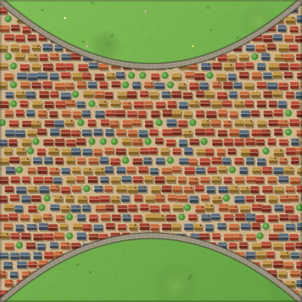 | `tile_band.png` | **Городская улица** | `fcfc · ×2` |
| 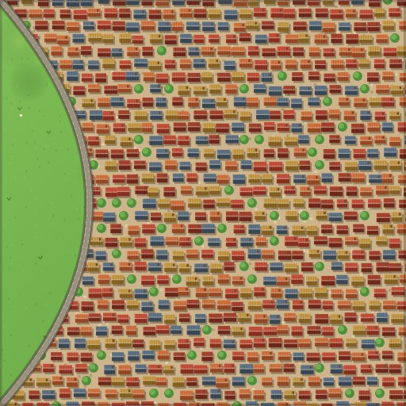 | `tile_c3.png` | **Большой город** | `cccf · ×3` |
| 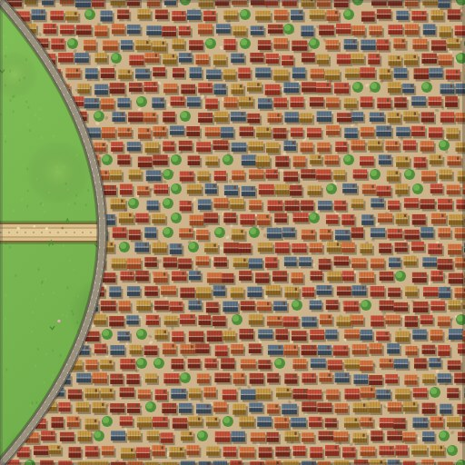 | `tile_c3r.png` | **Город с воротами** | `cccr · ×2` |
| 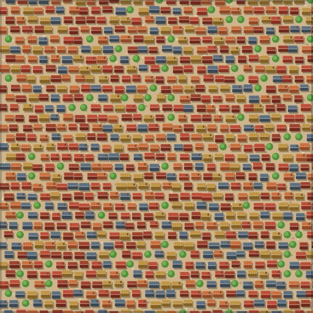 | `tile_c4.png` | **Центр города** | `cccc · ×1` |
| 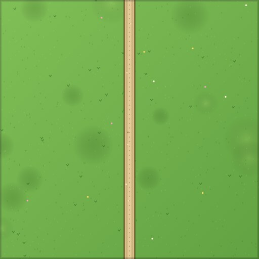 | `tile_rS.png` | **Прямая дорога** | `rfrf · ×6` |
| 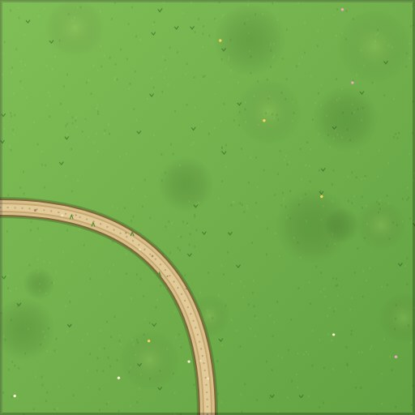 | `tile_rC.png` | **Поворот дороги** | `ffrr · ×6` |
| 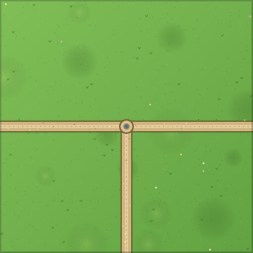 | `tile_r3.png` | **Развилка** | `frrr · ×3` |
| 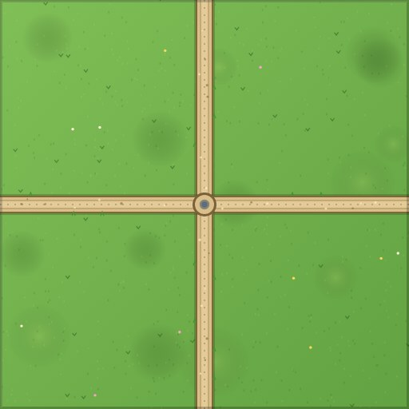 | `tile_r4.png` | **Перекрёсток** | `rrrr · ×1` |
| 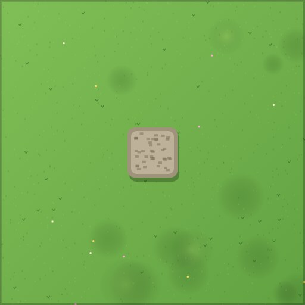 | `tile_fort.png` | **Крепость** | `ffff · ×3` |
| 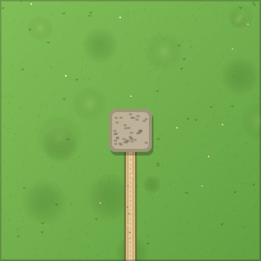 | `tile_fortR.png` | **Крепость с дорогой** | `ffrf · ×2` |
| 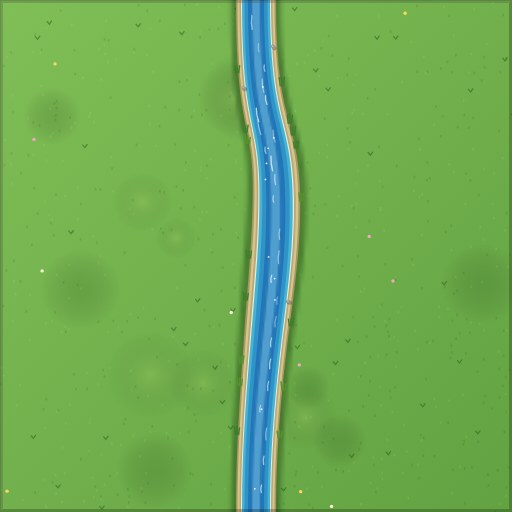 | `tile_wS.png` | **Река** | `wfwf · ×2` |
| 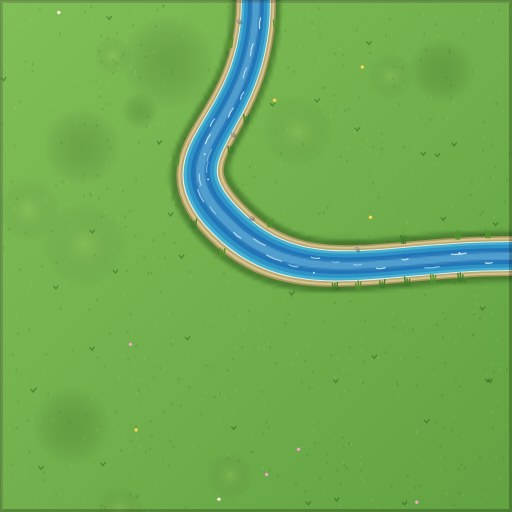 | `tile_wC.png` | **Излучина реки** | `wwff · ×2` |
| 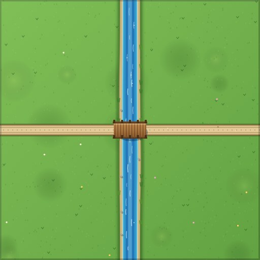 | `tile_wBr.png` | **Мост через реку** | `wrwr · ×2` |
| 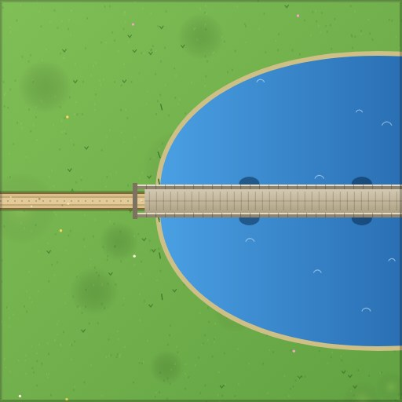 | `tile_brHalf.png` | **Половина большого моста** | `fbfr · ×2` |
| 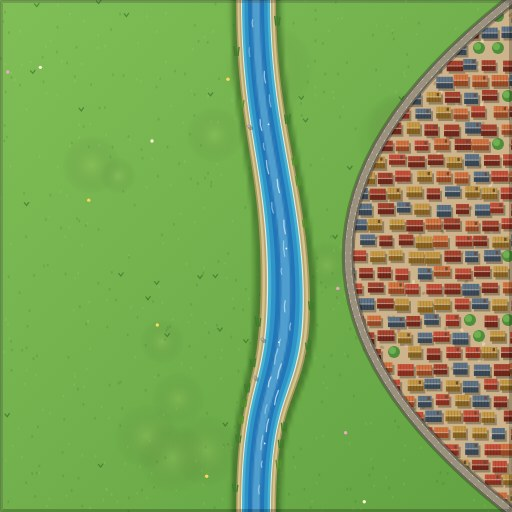 | `tile_wCity.png` | **Город у реки** | `wcwf · ×1` |
| 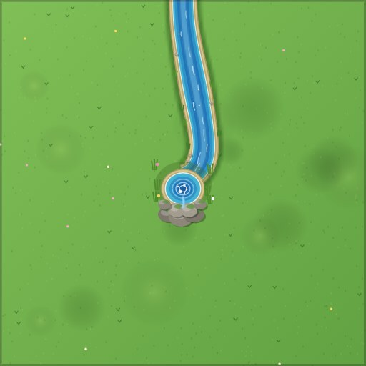 | `tile_wEnd.png` | **Исток реки** | `wfff · ×2` |
| 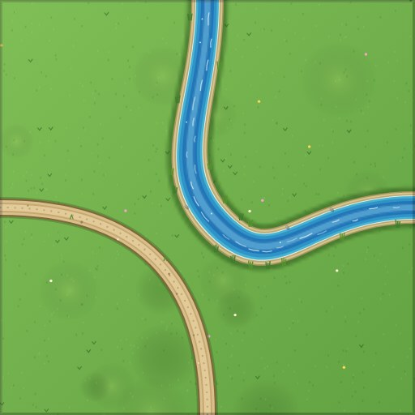 | `tile_wRC.png` | **Излучина и дорога** | `wwrr · ×1` |
| 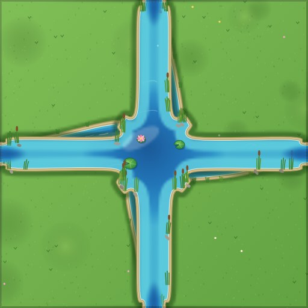 | `tile_wLake.png` | **Разлив реки** | `wwww · ×2` |
| 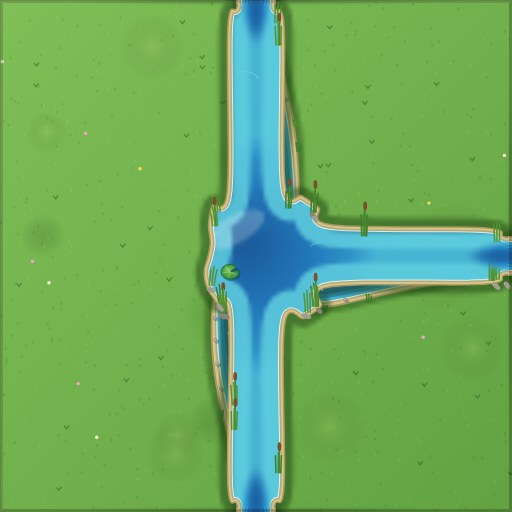 | `tile_wTee.png` | **Заводь с протокой** | `wwwf · ×2` |
| 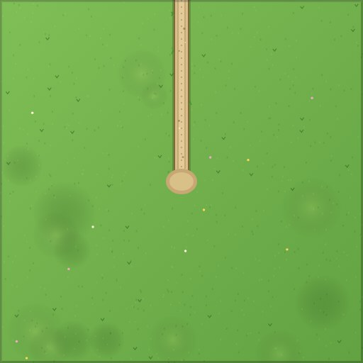 | `tile_rRock.png` | **Тупик у валунов** | `rfff · ×2` |
| 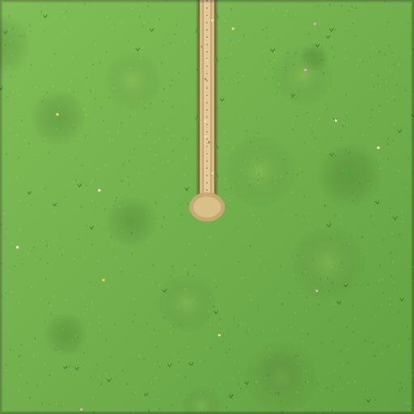 | `tile_rMine.png` | **Вход в шахту** | `rfff · ×2` |
| 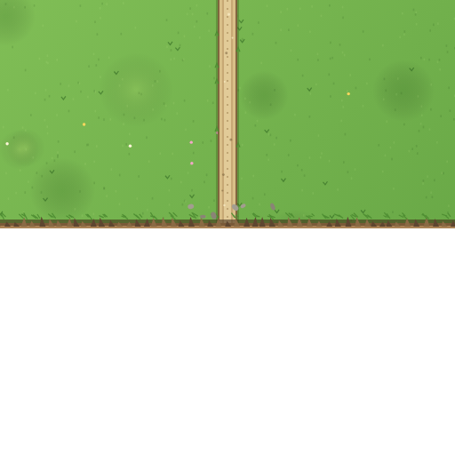 | `tile_rEnd.png` | **Дорога к обрыву** | `rfxf · ×1` |
|  | `tile_rocks.png` | **Валуны** | `ffff · ×2` |
| 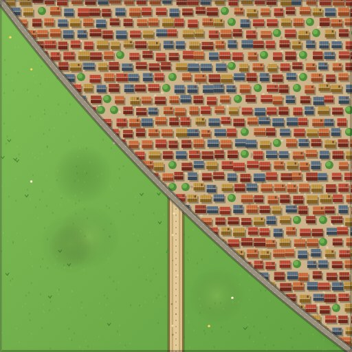 | `tile_xccrf.png` | **Город и дорога** | `ccrf · ×1` |
| 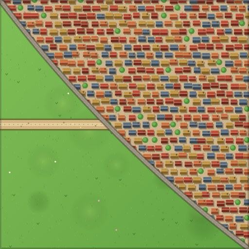 | `tile_xccfr.png` | **Город и дорога** | `ccfr · ×1` |
| 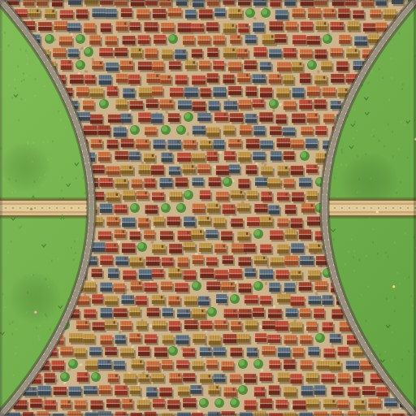 | `tile_xcrcr.png` | **Город и дорога** | `crcr · ×1` |
| 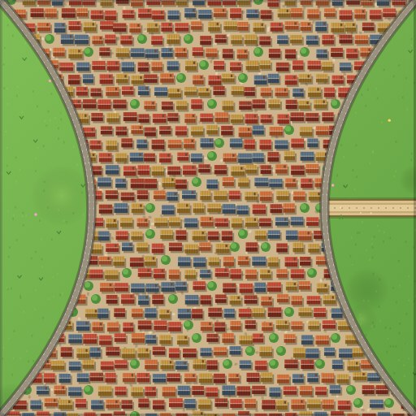 | `tile_xcrcf.png` | **Город и дорога** | `crcf · ×1` |
| 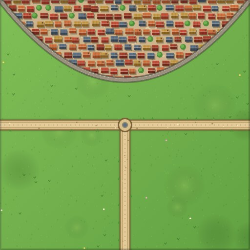 | `tile_xcrrr.png` | **Город и развилка** | `crrr · ×1` |
| 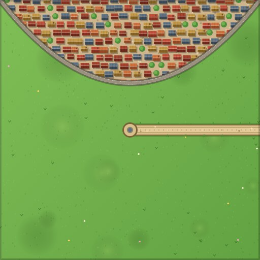 | `tile_xcrff.png` | **Город и дорога** | `crff · ×1` |
| 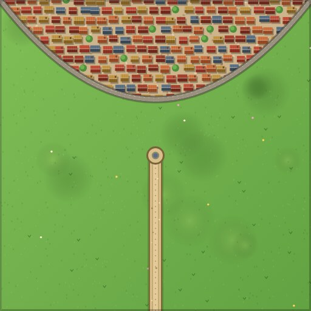 | `tile_xcfrf.png` | **Город и дорога** | `cfrf · ×1` |
| 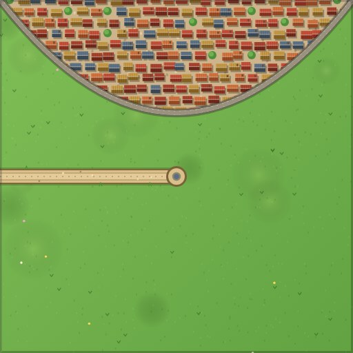 | `tile_xcffr.png` | **Город и дорога** | `cffr · ×1` |
